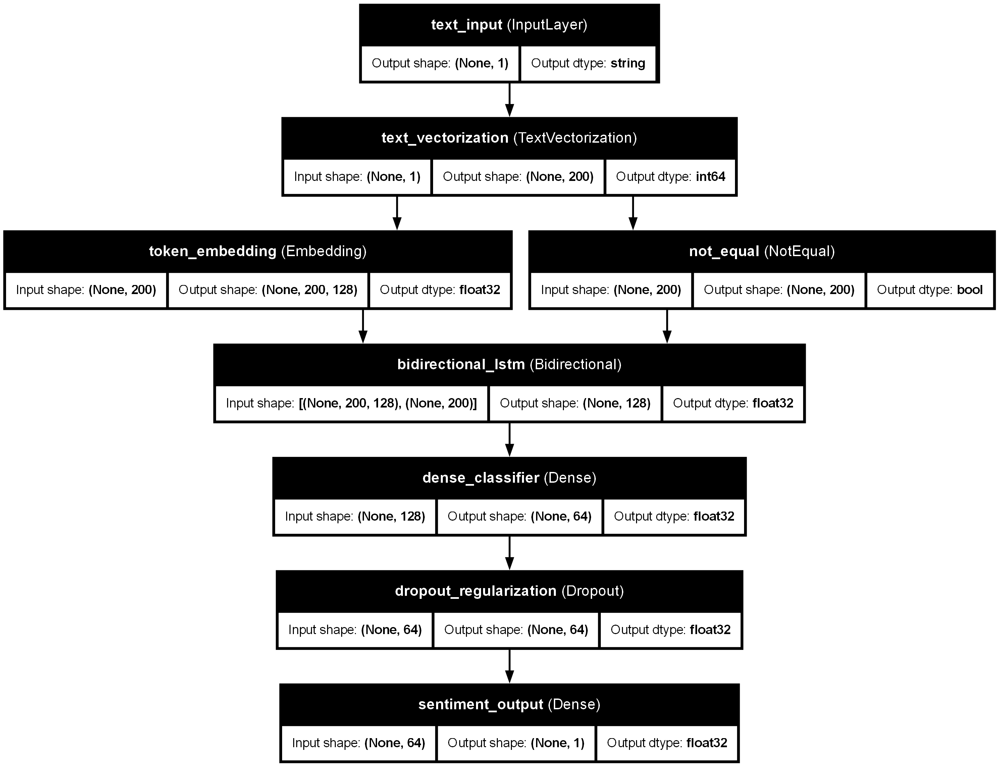

# Sentiment Analysis API

An end-to-end NLP project for binary sentiment classification on IMDb movie reviews, built with **TensorFlow** and exposed through a **FastAPI** REST API.

The project includes:
- a custom text preprocessing pipeline,
- a deep learning model based on **TextVectorization + Embedding + BiLSTM**,
- model serving with FastAPI,
- a clean modular structure ready for future improvements such as **Streamlit UI** and **Docker**.


---

## Table of Contents

- [Overview](#overview)
- [Features](#features)
- [Tech Stack](#tech-stack)
- [Project Structure](#project-structure)
- [Dataset](#dataset)
- [Model Architecture](#model-architecture)
- [Training Configuration](#training-configuration)
- [Results](#results)
- [Installation](#installation)
- [Train the Model](#train-the-model)
- [Run the API](#run-the-api)
- [API Documentation](#api-documentation)
- [Example Request](#example-request)
- [Example Response](#example-response)
- [Notes on Model Loading](#notes-on-model-loading)
- [Tests](#tests)
- [Future Improvements](#future-improvements)


---

## Overview

This project performs **binary sentiment analysis** on movie reviews.  
Given a raw text review, the model predicts whether the sentiment is **positive** or **negative**.

It was designed as a complete mini production-style NLP project with:
- model training in TensorFlow,
- reusable preprocessing logic,
- model serialization,
- and serving through a FastAPI API.

---

## Features

- Binary sentiment classification on **IMDb** reviews
- Deep learning pipeline built with **TensorFlow / Keras**
- Custom text cleaning with a reusable `custom_standardization` function
- `TextVectorization` integrated into the model pipeline
- **Bidirectional LSTM** for contextual sequence learning
- Validation split + **EarlyStopping**
- FastAPI inference service
- Architecture image included for documentation
- Project structure ready for **Streamlit** and **Docker**

---

## Tech Stack

- Python
- TensorFlow
- FastAPI
- Uvicorn
- Scikit-learn
- pandas
- NumPy

---

## Project Structure

```text
sentiment-analysis-api/
├── app/
│   ├── __init__.py
│   ├── main.py
│   ├── schemas.py
│   └── predict.py
├── src/
│   ├── __init__.py
│   └── sentiment_model/
│       ├── __init__.py
│       ├── config.py
│       ├── data.py
│       ├── preprocessing.py
│       ├── architecture.py
│       ├── training.py
│       └── evaluation.py
├── model/
│   ├── sentiment_model.keras
│   └── model_architecture.png
├── data/
│   ├── build_imdb_csv.py
│   ├── imdb_train.csv
│   ├── imdb_test.csv
│   └── aclImdb/
├── notebooks/
├── README.md
├── requirements.txt
└── .gitignore
```

Dataset files and trained model files are generated or obtained locally and are excluded from version control.

---

## Dataset

The model is trained on the **IMDb Large Movie Review Dataset** for binary sentiment classification.

### Official Dataset Source

The official dataset source used in this project is the **Large Movie Review Dataset** published by Stanford:

- [Official dataset page](https://ai.stanford.edu/~amaas/data/sentiment/)

In this project, the dataset is handled through:
- raw IMDb data (`aclImdb/`)
- CSV files prepared for training and evaluation:
  - `data/imdb_train.csv`
  - `data/imdb_test.csv`

Expected CSV format:

```text
text,label
"This movie was amazing",1
"I hated the ending",0
```

Where:
- `text` = review text
- `label` = sentiment label (`1` for positive, `0` for negative)

---

## Model Architecture

The model is built as an end-to-end TensorFlow pipeline that takes **raw text** as input and outputs a **binary sentiment probability**.

### Architecture Overview

- **InputLayer**: receives raw text as strings
- **TextVectorization**: converts text into integer token sequences of fixed length
- **Embedding**: maps tokens to dense vector representations
- **Bidirectional LSTM**: captures context from both directions
- **Dense + ReLU**: learns higher-level features
- **Dropout**: reduces overfitting
- **Dense + Sigmoid**: outputs a probability between `0` and `1`

### Model Diagram



### Padding and Masking

The embedding layer uses:

```python
mask_zero=True
```

This allows the model to ignore padding tokens added after vectorization.  
As a result, padded values do not interfere with sequence learning inside the LSTM.

### Input / Output

- **Input**: raw text review
- **Output**: probability between `0` and `1`
  - close to `1` → positive sentiment
  - close to `0` → negative sentiment

### Architecture Plot Generation

The PNG architecture file is generated with:

```python
tf.keras.utils.plot_model(...)
```

On Windows, **Graphviz** must be installed separately and added to the system `PATH`.

Check installation with:

```bash
dot -V
```

If Graphviz is not installed, training still works normally, but the architecture image will not be generated.

---

## Training Configuration

The training pipeline includes:
- TensorFlow `tf.data.Dataset`
- train / validation split
- custom text preprocessing
- model checkpointing through `.keras` serialization
- `EarlyStopping` to reduce overfitting

Main ideas used in training:
- raw text is cleaned through `custom_standardization`
- text is vectorized inside the model pipeline
- the final classifier predicts a sentiment score with sigmoid activation

---

## Results

The metrics below are historical results from an earlier training run. They have not yet been reproduced with the current code and are retained for reference pending reproducible evaluation.

| Metric | Score |
|---|---:|
| Train Accuracy | 90.65% |
| Validation Accuracy | 84.26% |
| Test Accuracy | 83.40% |

Best validation accuracy observed during training:

| Metric | Score |
|---|---:|
| Best Validation Accuracy | 85.08% |

Reproducible evaluation is needed before drawing conclusions about the current model's performance on unseen reviews.

---

## Installation

Run these commands from the project root:

```bash
python -m venv venv
```

Activate the virtual environment using the command for your terminal:

**Windows — PowerShell**

```powershell
.\venv\Scripts\Activate.ps1
```

**Windows — Git Bash**

```bash
source venv/Scripts/activate
```

**macOS / Linux — Bash or Zsh**

```bash
source venv/bin/activate
```

Then install the dependencies:

```bash
python -m pip install -r requirements.txt
```

---

## Train the Model

Run this command from the project root with the virtual environment activated.

```bash
python -m src.sentiment_model.training
```

This script:
- loads the training data,
- prepares the TensorFlow pipeline,
- trains the BiLSTM model,
- evaluates training and validation performance,
- and saves the trained model.

The test set is excluded from this training workflow and reserved for
the final comparison. A separate final-evaluation command is not yet implemented.

---

## Run the API

Run this command from the project root with the virtual environment activated.

The trained model must already exist at `model/sentiment_model.keras`.
If it is missing, complete the data preparation and training steps first.
Starting the API loads the saved model; it does not train it.

```text
uvicorn app.main:app --reload
```

Wait for `Application startup complete.`, then open:
http://127.0.0.1:8000/docs

The `--reload` option restarts the application when source files change during development.
Press `Ctrl+C` in the terminal to stop the server.

---

## API Documentation

FastAPI automatically generates interactive documentation at:

```text
http://127.0.0.1:8000/docs
```

---

## Example Request

Send a `POST` request to `/predict` with `Content-Type: application/json`.

The request body must contain a `text` field with a non-empty string.
Strings containing only whitespace are rejected.
Missing or invalid `text` values return HTTP `422`.

```json
{
  "text": "I really loved this movie. The acting was great and the story was moving."
}
```

---

## Example Response

An illustrative successful response (HTTP `200`):

```json
{
  "prediction": "positive",
  "score": 0.8214
}
```

- `prediction`: the selected class, either `positive` or `negative`.
- `score`: the model score for the selected class, rounded to four decimal places.

The model outputs a positive-class score `p`. The API selects `positive`
when `p >= 0.5`, otherwise `negative`. The returned score is `p` for a
positive prediction and `1 - p` for a negative prediction.

This score does not guarantee that the prediction is correct.

---

## Notes on Model Loading

The project uses a custom preprocessing function:

```python
custom_standardization
```

Because this function is part of the serialized TensorFlow pipeline, the model must be loaded with `custom_objects` in FastAPI:

```python
custom_objects={"custom_standardization": custom_standardization}
```

This ensures that inference uses the exact same preprocessing logic as training.

---

## Tests

From the project root, activate the virtual environment and install
the development dependencies:

```text
python -m pip install -r requirements-dev.txt
```

Run the automated tests:

```text
python -m unittest discover -s tests -v
```

The tests cover input validation, internal error handling, and HTTP
prediction endpoints with simulated predictions.

They do not require the saved model or a running Uvicorn server.
TensorFlow is still imported by the application during test discovery.

These tests do not evaluate the trained model's predictive quality.

---

## Future Improvements

- Improve performance through hyperparameter tuning
- Compare BiLSTM with GRU, CNN, and Transformer-based models
- Add a Streamlit frontend
- Containerize the application with Docker
- Deploy the API to Google Cloud Run
- Add automated tests for inference and API endpoints
